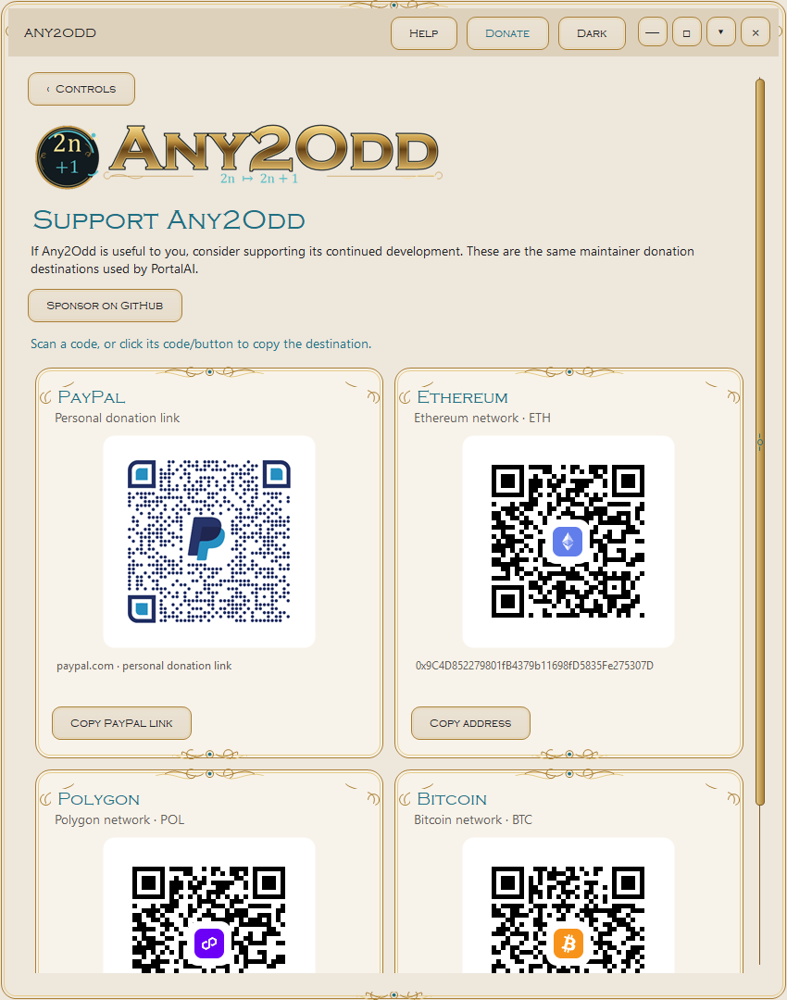

# Supporting Any2Odd

If Any2Odd is useful to you, you can support continued development through the maintainer's [GitHub Sponsors profile](https://github.com/sponsors/Zhandragon), PayPal or the cryptocurrency destinations in **Donate**.

**Donate stays inside the main controls window.** Use **Controls** to return. The Windows page does not stop active conversion. **Sponsor on GitHub** opens the maintainer profile in a browser; the repository and illustrated guide use PortalAI's original teal/gold heart button, with the same destination. The GitHub repository Sponsor menu is configured through `.github/FUNDING.yml`.

The original PayPal, Ethereum, Polygon and Bitcoin QR images and exact destinations are shared with PortalAI. Copy buttons place a destination on the clipboard and do not initiate a payment. Ethereum and Polygon use the same address with distinct network labels. The experimental portable app uses these same destinations and original images.

QR image provenance and hashes are in [PROVENANCE.json](../assets/donations/PROVENANCE.json). Sponsor artwork was copied byte-for-byte from [PortalAI's documentation asset](https://github.com/Zhandragon/PortalAI/blob/e0f9de3b074b11fd63ea860f2827716d4ac0f0e6/Documentation/assets/sponsor-button.svg). Any2Odd and PortalAI are independent applications maintained by the same author.
