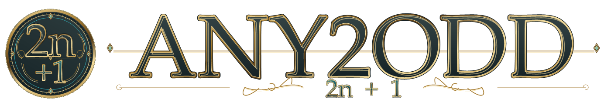
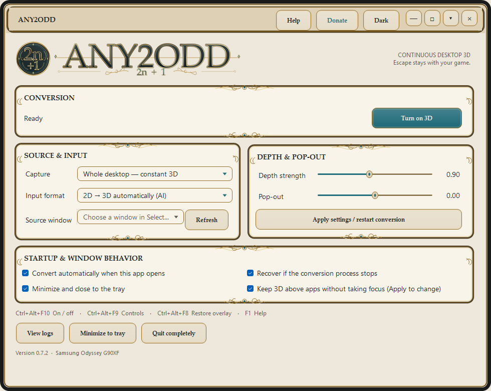
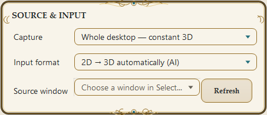
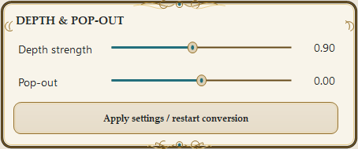
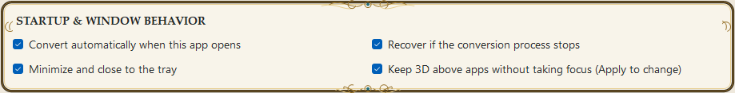
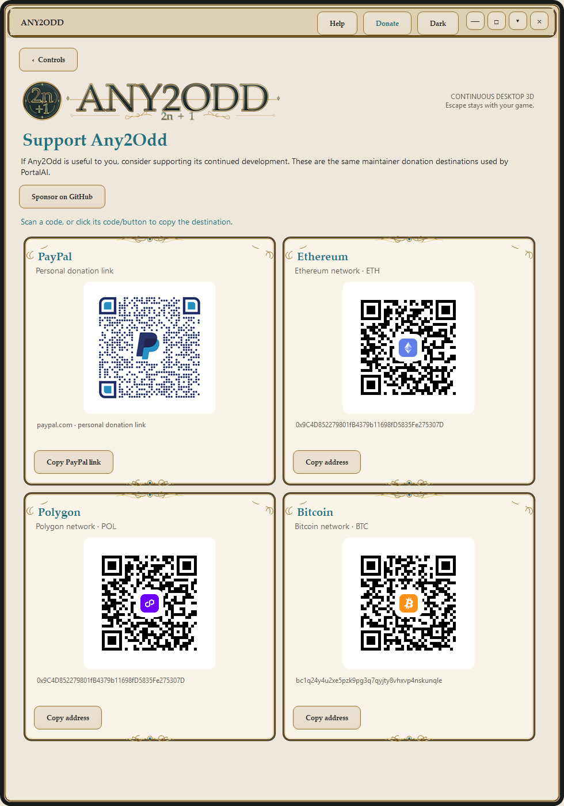

# Illustrated Help

Any2Odd 0.7.2 · Windows edition reference, with a separate experimental macOS/Linux topic.

[Repository](../README.md) · [Platform support](PLATFORMS.md) · [Donations](DONATIONS.md)

The same written topics are included inside the app and in `USER-GUIDE.html`. Screenshots are provided here and in the repository README only. Screenshots show real Windows controls in an isolated preview; conversion was not started. They do not demonstrate optical 3D or macOS/Linux operation.

[Getting started](#start) · [Capture modes](#capture) · [Input, depth & pop-out](#input) · [Overlay & click-through](#overlay) · [Window, tray & shortcuts](#tray) · [Automatic start & recovery](#automation) · [Dependencies & architecture](#dependencies) · [Display checks & startup](#detection) · [Origins & credits](#origins) · [Windows, Linux & macOS](#platforms) · [Troubleshooting & logs](#troubleshooting) · [Install, update & uninstall](#updates) · [Experimental macOS / Linux](#portable)

## Getting started

Any2Odd provides continuous desktop capture and controls for Samsung's installed Odyssey 3D conversion engine. Start with Whole desktop and AI input for ordinary desktop content.

1. Connect DisplayPort and the USB upstream cable to your Odyssey G90XF. Install the supported Odyssey 3D Hub and its LeiaSR components; verify Samsung's ordinary 3D playback, then stop its separate conversion player.
2. In Windows display settings, make the Odyssey the primary screen at 3840 × 2160 in landscape orientation.
3. Open Any2Odd. Convert automatically when this app opens is enabled on a fresh installation, so it attempts to start after registering its shortcuts and checking prerequisites. Existing installations keep their saved choice. If automatic conversion is disabled, click Turn on 3D.
4. Allow a few seconds for startup. Read the status above the button: Ready is idle, Starting 3D is initialization, and 3D active means the worker reported its output ready. Errors appear here too. A screenshot cannot establish that optical 3D is working.
5. Minimize the controls and use windowed or borderless apps/games. Ctrl+Alt+F10 turns conversion off or on; Quit completely stops conversion and exits.

The installer does not add Any2Odd to Windows sign-in startup. Launching the app and starting Windows are separate events. The default shown in the repository screenshots is an unsaved preview; the screenshot preview never starts conversion.

Use the Source & input, Depth & pop-out and Startup & window behavior sections on the Controls page to adjust conversion. After changing capture, input, depth, pop-out or overlay preferences, click Apply settings / restart conversion. Help and Donate stay inside the controls window.

**CONTROLS WITHOUT A 3D SETUP**

Install-GUI.cmd installs the Windows controls, tray, Help and Donate without Hub or a Samsung display. It cannot perform 3D conversion. Automatic conversion still uses the normal prerequisite checks and reports the missing engine/worker; it leaves 3D off. Uncheck Convert automatically when this app opens if you only want to explore the controls. Later, install the supported Samsung setup and run Install.cmd to add full conversion without losing preferences.

**DEFAULT LAYOUT**

The Windows controls open at 980 × 780 logical pixels. Source and depth settings sit side by side, with startup/window behavior below; all controls fit at the default size and normal display scaling. Narrower windows stack the settings, and shorter windows scroll with the themed bar or mouse wheel. On a smaller work area or with larger display scaling, Windows may constrain the initial window and scrolling remains available.

[Samsung monitor setup](https://www.samsung.com/uk/support/displays/how-to-use-3d-on-the-odyssey-3d-gaming-monitor/)

## Capture modes

**WHOLE DESKTOP**

The recommended mode for games and direct interaction. Captures the primary desktop, including wallpaper, icons and capturable app windows, into a GPU surface outside all physical monitors. The output is excluded from capture to prevent feedback trails; the hardware cursor is excluded to avoid a delayed duplicate pointer.

**SELECTED WINDOW**

Choose a visible window in Source window. Refresh rebuilds the list. The selected window is fitted to the output, preserving its aspect ratio.

**FOLLOW ACTIVE WINDOW**

Follows the last eligible foreground window intersecting the primary display. Source window provides the initial selection. Any2Odd's own process and the capture worker are excluded from eligible sources.

Selected and active window modes are experimental. Scaling a window does not remap mouse coordinates. Use Whole desktop for aligned mouse interaction.

After changing capture mode or source, click Apply settings / restart conversion. If 3D is off, settings are saved for the next start.

**DEFAULTS AND EXAMPLE**

Capture defaults to Whole desktop. In that mode, Source window is intentionally disabled because the entire primary display is the source. For a particular app: open the app, choose Selected window, click Refresh, choose its title, and click Apply. Refresh only updates the list; it does not change the capture mode or restart conversion. The window choice is a live handle and is not saved as a durable per-app profile.

## Input, depth & pop-out

**2D → 3D AUTOMATICALLY (AI)**

Use for ordinary desktop content, apps and 2D video. Samsung's engine estimates depth. AI depth can contain artifacts.

**SIDE-BY-SIDE INPUT (MANUAL)**

Use for a source already containing a left/right stereo pair. Automatic stereo-layout detection is not enabled. The tray's Side-by-side mode and AI conversion mode commands save the choice and restart active conversion.

**DEPTH STRENGTH**

Range 0.00–2.00; default 0.90. Changes the engine's depth strength. Start at 0.90 and adjust in small steps; stronger depth can make estimation errors more noticeable. The numeric readout is a numeric engine setting, not centimeters or a measured distance.

**POP-OUT**

Range −1.00–1.00; default 0.00. Adjusts Samsung's pop-out setting, which affects the apparent depth placement relative to the screen. Start at neutral 0.00, change a little, then judge the result at the monitor. These are engine units; the slider does not measure physical protrusion.

**APPLY SETTINGS / RESTART CONVERSION**

Saves current settings. If conversion is active, it stops the owned worker and starts it again, causing a brief interruption. With conversion off, Apply only saves. Values are stored separately for standard versus side-by-side input in Samsung's overlay settings; Any2Odd keeps your selected values in its own preferences.

**WHEN CHANGES TAKE EFFECT**

Moving a slider updates its readout immediately but does not change the running worker. Apply saves the values and briefly restarts active conversion. With 3D off, the next Turn on 3D uses the displayed settings. Changes to the automatic-start, recovery or tray checkboxes also save the current form values; they do not apply new capture/depth settings to an already running worker.

**CHOOSING THE RIGHT INPUT**

AI is the default for ordinary images. Side-by-side is for content that already has separate left/right images: it still requires the Samsung/Leia display stack. Any2Odd does not automatically recognize stereo layouts or obtain a game's native depth buffer.

## Overlay & click-through

The 3D output passes mouse input through to the real desktop or game. Any2Odd does not intercept Escape as a stop command. Use Ctrl+Alt+F10 to toggle conversion.

**KEEP 3D ABOVE APPS WITHOUT TAKING FOCUS**

Keeps output above other applications while preserving their keyboard focus. Click Apply after changing the checkbox. The same toggle in the tray/context menu applies immediately with a brief restart.

**RESTORE OVERLAY — CTRL+ALT+F8**

Restores output without taking game focus. It requires an active conversion worker. With persistent topmost behavior disabled, use this shortcut if output falls behind another app.

The controls window is separate from the output surface. Moving, resizing, minimizing or hiding these controls does not change projection geometry or click-through behavior. Minimize the controls when playing.

Use borderless/windowed games. Exclusive fullscreen and protected surfaces may not capture. Windows taskbar auto-hide remains controlled by Windows; other apps' attention requests can keep it visible.

## Window, tray & shortcuts

**CUSTOM WINDOW CONTROLS**

Drag the title bar to move the controls. Drag any border/corner to resize; double-click the title bar or use the square button to maximize/restore. The down-arrow button explicitly minimizes to the tray.

**MINIMIZE AND CLOSE TO THE TRAY**

Enabled by default. The minus and close buttons hide the controls while conversion keeps running. When unchecked, minus minimizes to the taskbar and close exits the application. Explicit Minimize to tray is always available.

**RESTORE**

Double-click the notification-area icon, launch the desktop shortcut again, or press Ctrl+Alt+F9. Windows may place the tray icon in its overflow area.

**RIGHT-CLICK**

Right-click the tray icon or the controls window for conversion, input mode, overlay recovery, Help, Donate and Quit commands. The taskbar jump list also includes toggle and show-controls commands.

**SHORTCUTS**

Ctrl+Alt+F10 — toggle 3D 
Ctrl+Alt+F9 — show controls 
Ctrl+Alt+F8 — restore output without game focus 
F1 — Help while the controls have focus 
Alt+F4 — close (honors the tray preference)

Quit completely always stops conversion and exits. Help and Donate are internal panels in the same controls window and do not pause the worker. Use Controls to return. The Light / Dark button changes the desktop theme without restarting conversion; its choice is saved separately in ui-settings.json.

**RESPONSIVE CONTROLS**

Source & input and Depth & pop-out use two columns at the default width and stack when the window is narrower. Startup & window behavior follows beneath them. The default window fits the controls at normal scaling; scrolling remains available at smaller sizes. Resizing changes only the desktop layout, never capture or projection geometry.

## Automatic start & recovery

**CONVERT AUTOMATICALLY WHEN THIS APP OPENS**

Enabled by default. Starts conversion after the controls open and global shortcuts register successfully. This does not add Any2Odd to Windows sign-in startup.

**RECOVER IF THE CONVERSION PROCESS STOPS**

Enabled by default. When a running conversion worker exits unexpectedly, waits 8 seconds and retries, up to three recovery attempts. Turning conversion off cancels recovery. Starting conversion yourself resets the retry count.

**HOTKEY CONFLICTS**

Startup conversion is blocked if Ctrl+Alt+F8/F9/F10 cannot all register. Free the conflicting shortcuts in the other application and reopen Any2Odd.

Your preferences remain in %LOCALAPPDATA%\Odyssey3DCompanion\settings.json. The legacy folder name preserves existing installations. Changing automatic start, recovery or minimize-to-tray saves the current preferences. Apply explicitly restarts active conversion for capture, input, depth and overlay changes.

**CAMERA/DISPLAY NOT READY AT LAUNCH**

A failed prerequisite check leaves conversion off and shows the reason. Recovery is for an exited worker; it is not a background monitor-discovery or hot-plug service. After fixing the camera/display or stopping Samsung's player, click Turn on 3D again.

**SAVE BEHAVIOR**

Automatic start, recovery and minimize-to-tray changes save immediately. Their enabled state is remembered across upgrades. Keep 3D above apps defaults to enabled and uses Apply to update active conversion. The title-bar Light / Dark button saves only the desktop theme and takes effect immediately without restarting conversion.

## Dependencies & architecture

**WHAT ANY2ODD PROVIDES**

The desktop GUI, tray menu, settings, shortcuts, capture source, overlay positioning, click-through input handling and worker recovery are Any2Odd code. The capture feeds an off-screen surface; the output is excluded from capture to prevent feedback. Rendering stays on this computer; Any2Odd does not send captured frames to a hosted conversion service.

**SAMSUNG ODYSSEY 3D HUB — REQUIRED FOR WINDOWS 3D**

Install Odyssey 3D Hub 1.5.1 with the exact supported ConversionWrapper.dll. Any2Odd loads that native library directly for AI depth, stereo conversion and output. It does not include Samsung's engine, AI models or calibration files. Both AI and side-by-side input depend on the installed engine. A Hub update that changes this DLL requires an Any2Odd compatibility update.

**HUB WINDOW VERSUS RUNTIME**

Any2Odd's code does not require the Hub's main window to stay open. Samsung/Leia background components and the camera must still be operational; the Hub may be needed to set up or initialize them. Stop the separate Odyssey3DPlayer before starting Any2Odd. Closing the Hub window and uninstalling Hub are very different: uninstalling removes required components.

**LEIASR AND HARDWARE — REQUIRED FOR WINDOWS 3D**

The installed LeiaSR runtime, eye tracking, monitor calibration and the G90XF's optical hardware produce the calibrated glasses-free image. Keep the display's USB upstream connected as well as DisplayPort. The software does not turn an ordinary 2D monitor into a glasses-free display.

**WINDOWS — REQUIRED**

Windows 11 x64 24H2 (build 26100) or newer is the supported baseline. Any2Odd uses WinForms/.NET Framework 4.8 or its compatible Windows-supplied 4.8.1 replacement, Win32 window styles/hotkeys, Windows Graphics Capture, DWM, Direct3D 11 and DXGI. The capture code calls MinUpdateInterval, available from Windows build 26100. These are functional OS dependencies, not just installer restrictions.

**GPU AND LIBRARIES**

The tested setup is G90XF + NVIDIA RTX 4090; other GPUs remain unvalidated. The current engine call passes a fixed 16,384-core hint. Install a compatible GPU driver. SharpDX 4.2.0 DLLs are bundled with Any2Odd and are MIT licensed; SharpDX is archived. Samsung supplies its own native conversion dependencies. This release has no independent CPU conversion fallback.

**INSTALLATION AND BUILD TOOLS**

The full Install.cmd installer uses 64-bit Windows PowerShell 5.1 and administrator access to place the worker beside Samsung's engine. Install-GUI.cmd instead installs controls only under your Windows account, without Hub, a Samsung display or elevation; it cannot convert to 3D and never installs a worker. Both modes need the same supported Windows/.NET baseline. Run the app afterward as your normal user. Python, Node, Visual Studio and a separately installed CUDA Toolkit are not Any2Odd prebuilt-package prerequisites. Source builds use the Windows .NET compiler and pinned NuGet packages; regenerating documentation additionally uses Python 3. Internet access is needed to obtain software and for optional external links.

**ANY2C1 / PORTALAI**

Neither is a runtime or installation dependency. Any2C1 inspired the continuous-conversion workflow. PortalAI supplies a visual reference and shared maintainer donation artwork. See Origins & credits for attribution.

[Windows capture interval API](https://learn.microsoft.com/en-us/uwp/api/windows.graphics.capture.graphicscapturesession.minupdateinterval)

[SharpDX source and license](https://github.com/sharpdx/SharpDX)

## Display checks & startup

**WHAT IS CHECKED BEFORE CONVERSION**

1. Samsung's ConversionWrapper.dll exists at the expected installation path and matches the supported SHA-256 hash.
2. Any2Odd's worker executable is installed.
3. Windows reports the primary screen as 3840 × 2160.
4. Windows lists a device named 3D Stereo WebCam with ConfigManagerErrorCode equal to zero.
5. Samsung's separate Odyssey3DPlayer process is not running.

**WHAT IS NOT DETECTED**

Any2Odd does not currently read the display's EDID model/manufacturer to positively identify a G90XF, enumerate generic 3D capabilities, select a compatible secondary monitor, or switch primary displays for you. A 4K resolution and a present camera are preliminary checks, not proof that the correct screen, tracking or optical output works.

**CONNECTING A SCREEN LATER**

Checks run when starting conversion. There is no automatic hot-plug activation service. After connecting the monitor or restoring its USB camera, confirm Windows display settings and click Turn on 3D. If monitor dimensions change during capture, the worker stops and requests a restart. Recovery may retry exited workers, but a failed prerequisite check leaves conversion off.

**AUTOMATIC START**

Convert automatically when this app opens defaults to enabled. The app first registers Ctrl+Alt+F8/F9/F10; a conflict prevents automatic conversion. The installer does not register a Windows startup entry. The saved automatic-conversion preference is preserved on upgrade.

**READ-ONLY INSTALLER CHECK**

install.ps1 -CheckOnly checks full-install package/version/engine compatibility. Add -ControlsOnly for a read-only GUI-install check without requiring Hub. Neither check runs capture, confirms camera tracking, or verifies optical 3D. Check ordinary Samsung playback on the target monitor when diagnosing a display problem.

## Origins & credits

**ANY2C1 AND CUBEVI C1**

Any2C1 is the companion/conversion app for CubeVi's C1 spatial display, also called Companion 01. It inspired Any2Odd's continuous desktop-conversion and tray-control workflow. The project maintainer identified this specific C1 app as the reference. CubeVi's official site documents the C1 hardware and its broader CubeStage software suite.

Any2Odd is a separate implementation for the Samsung Odyssey G90XF. It is not an Any2C1 fork, does not ship or load Any2C1 code, and does not need a CubeVi account, C1 display or CubeStage installation. The inspiration does not imply support for CubeVi hardware or endorsement by CubeVi.

**PORTALAI**

PortalAI, also maintained by Zhandragon, is the reference for the ivory/graphite, gold and turquoise desktop presentation. Its sponsor-button artwork and maintainer-provided donation QR files are reused unchanged. Any2Odd does not need PortalAI installed. The mathematical 2n → 2n + 1 identity and generated icon are Any2Odd's own branding.

**SAMSUNG / LEIA / MICROSOFT**

Samsung's installed engine performs the conversion; Samsung/Leia runtime components provide tracked, calibrated display output. Microsoft Windows provides capture, composition and desktop APIs. These dependencies are separate products, not bundled parts of Any2Odd's GPL code.

**LICENSES AND ATTRIBUTION**

Any2Odd's code is GPL-3.0-only. SharpDX and the referenced Microsoft capture interop samples carry MIT notices in THIRD-PARTY-LICENSES.txt. Samsung/Leia components remain separately obtained and licensed. Donation-asset hashes and PortalAI source provenance are recorded in the repository. Source and upstream links are available in the offline guide.

[CubeVi C1 user guide](https://cubevi.com/pages/cube-c1-user-guide)

[CubeVi software downloads](https://cubevi.com/pages/download-page)

[PortalAI repository](https://github.com/Zhandragon/PortalAI)

## Windows, Linux & macOS

**CURRENT DISTRIBUTION**

The full Samsung Odyssey converter is Windows x64 only. Experimental source-based macOS and Linux launch bundles provide a shared Qt desktop frontend and limited stereo-format conversion. These builds have not been tested on macOS or Linux. See Experimental macOS / Linux for exact capabilities and setup.

**WHY A DIFFERENT INSTALLER IS NOT ENOUGH**

The application relies on WinForms/.NET Framework, Win32 overlay/input styles, Windows Graphics Capture, Direct3D surfaces and Samsung's Windows ConversionWrapper.dll. A port needs replacement capture, GUI, conversion and calibrated output implementations. Wine/Proton and virtual machines are not validated ways to use this display pipeline.

**LINUX FEASIBILITY**

DisplayXR publishes a Linux runtime and a LeiaSR plug-in integration path. That makes native output a candidate for investigation; it does not establish that Any2Odd or the G90XF's camera, lens switching and calibration work on Linux. A port would need a compatible native runtime, independent conversion, PipeWire/portal or X11 capture, and tested output exclusion/click-through behavior for the chosen desktop compositor.

**MACOS FEASIBILITY**

Apple ScreenCaptureKit can provide native screen capture. The DisplayXR macOS path examined uses a simulated display backend; verified G90XF output and tracking are still missing. Apple silicon also cannot run the current x64 Samsung engine natively. A usable port requires a native converter and a compatible hardware runtime, then validation on an actual Mac with the display.

**RELEASE STATUS**

The macOS/Linux bundles are explicitly experimental and untested on their target operating systems. They do not contain a port of Samsung AI or calibrated Odyssey output. Shared stereo-conversion and offscreen UI tests run on Windows only. Hardware conversion remains future backend work. See the platform assessment for evidence and the proposed development sequence.

[Detailed platform assessment](https://github.com/Zhandragon/Any2Odd/blob/main/Documentation/PLATFORMS.md)

[DisplayXR architecture](https://displayxr.org/architecture)

[LeiaSR plug-in source](https://github.com/DisplayXR/displayxr-leia-plugin)

[Apple ScreenCaptureKit](https://developer.apple.com/documentation/screencapturekit)

[XDG ScreenCast portal](https://flatpak.github.io/xdg-desktop-portal/docs/doc-org.freedesktop.portal.ScreenCast.html)

## Troubleshooting & logs

**INSTALLER SAYS INSTALLATION DID NOT COMPLETE**

Use the 0.7.1 or newer release ZIP and extract it fully. The launcher keeps the precise failure visible in the original console, including failures after elevation. Missing Odyssey Hub blocks full setup. For desktop controls on a PC without a 3D setup, run Install-GUI.cmd; 3D conversion will remain unavailable. For full setup, install the supported Samsung Hub first and run Install.cmd using the same Windows account as the existing installation. Do not bypass an incompatible-engine check.

**NO 3D / CAMERA ERROR**

Check USB upstream, DisplayPort, the 3D Stereo WebCam in Device Manager, primary-display selection and 3840 × 2160 resolution. Verify Samsung playback first and stop its separate conversion player.

**ENGINE MISSING OR CHANGED**

Install the supported Odyssey 3D Hub in its default location. Any2Odd checks a specific ConversionWrapper.dll hash. A changed engine requires a compatibility update; do not bypass this check.

**OUTPUT BEHIND A GAME**

Use Ctrl+Alt+F8 and Keep 3D above apps. Exclusive fullscreen is unsupported.

**YELLOW CAPTURE OUTLINE**

Windows may deny borderless capture access. Capture can continue with its indicator visible; Any2Odd does not disable Windows privacy protections.

**CAPTURE LIMITS**

Protected/DRM video, secure desktops, exclusive fullscreen and apps that stop rendering when occluded may not work. HDR input is normalized to SDR; highlights can clip. Capture and AI conversion add latency, which depends on workload.

**VIEW LOGS**

Opens %LOCALAPPDATA%\Odyssey3DCompanion. companion.log records application events; worker-status.json and desktop-capture-status.json show available worker/capture diagnostics. Review and redact usernames, window titles and paths before sharing logs. Include Windows build, GPU, Hub version, capture/input mode and reproduction steps in an issue. Optical depth must be checked at the 3D monitor.

## Install, update & uninstall

**UPDATING FROM 0.5.0 THROUGH 0.7.1**

Download the new prebuilt Any2Odd ZIP from GitHub Releases and extract the entire package to a new folder. Run Install.cmd, or run install.ps1 in 64-bit administrator PowerShell using the same Windows account as the existing installation. Do not uninstall first.

The installer reads installed executable/version metadata, reports install/upgrade/repair, asks the running Any2Odd instance to quit cleanly, and replaces the application and worker in their existing locations. Settings, logs and Samsung's original overlay-settings backup are preserved. The same version can be reinstalled to repair it; this installer refuses to replace a newer installed version unless -AllowDowngrade is explicitly passed. Do not run the old 0.5.0 installer to update a newer installation; it predates version checks.

Use install.ps1 -CheckOnly for a read-only full-install compatibility/version check. No reboot is required. Full installation requires the supported Samsung engine; it does not patch Samsung binaries.

**CONTROLS-ONLY INSTALLATION**

Without Hub or a Samsung display, use Install-GUI.cmd (or install.ps1 -ControlsOnly) for the desktop GUI, tray, written Help and Donate. It needs no administrator access and appears as Any2Odd (controls only) in Installed apps. It installs no worker and provides no 3D conversion. Use this same launcher for controls-only updates or repair; add -ControlsOnly to -CheckOnly for read-only validation.

Later, install the supported Samsung setup and run Install.cmd from the same or a newer release to add full conversion in place, preserving settings. Controls-only setup refuses to replace an installed full worker; use Install.cmd on your 3D computer to update the app and worker together. The launcher shows exact prerequisite/elevated errors and rejects elevation under a different Windows account.

**UNINSTALL**

Use Any2Odd in Windows Installed apps. Full-mode removal deletes its own files and unchanged engine dependencies it owns. Controls-only removal needs no elevation and never deletes anything from Samsung's folders. It retains Samsung software, preferences, logs and the original Samsung overlay-settings backup. It does not restore the backup over newer Samsung preferences.

**DONATE**

Donate opens the maintainer's GitHub Sponsors, PayPal and cryptocurrency options, using the same QR codes as PortalAI. Copying a destination does not send a payment. Any2Odd remains an independent application.

**SPONSORSHIP**

The Sponsor on GitHub button opens https://github.com/sponsors/Zhandragon in your browser. The README and documentation use the same teal/gold heart artwork as PortalAI. Donation support goes to the same maintainer; it does not imply affiliation between these applications. Donation destinations and QR data are unchanged.

[Any2Odd releases](https://github.com/Zhandragon/Any2Odd/releases)

[Sponsor Zhandragon](https://github.com/sponsors/Zhandragon)

## Experimental macOS / Linux

**EXPERIMENTAL AND NOT TESTED ON MACOS OR LINUX**

These source-based launch bundles reuse Any2Odd branding, light/dark controls, tray behavior, Help and donation assets in a small Qt frontend. The full Samsung Odyssey conversion backend remains Windows-only. No Odyssey Hub, Samsung screen or Any2C1 is needed for portable image conversion.

**SETUP**

Extract the whole bundle. Provide Python 3.10–3.13 with venv/pip. On macOS 13 or newer (Intel/Apple silicon), open Launch-macOS.command, or run it with sh in Terminal. On Linux x86-64 with glibc 2.34 or newer and a graphical desktop, run sh launch-linux.sh. The first launch creates a private .venv and downloads PySide6 6.10.1 from PyPI. Internet is needed for setup. Native desktop/capture dependencies and permissions remain the operating system's responsibility.

**SOURCE AND INPUT**

Open a PNG/JPEG/BMP file. Choose Side-by-side stereo pair when the image already contains left and right views. Choose 2D image for a flat preview. Ordinary 2D images are not converted to AI depth. Image-file input works without a special screen.

**STEREO CONVERSION**

Red/cyan anaglyph takes the left eye's red channel and the right eye's green/blue channels; view it with matching glasses. Side-by-side preserves the stereo layout for a compatible viewer. Swap left and right eyes corrects reversed pairs. Half-width SBS stretches compressed eye views for anaglyph; uncheck it for full-width stereo. Save preview PNG exports the current converted image. Neither output mode activates the Odyssey's calibrated glasses-free mode.

**EXPERIMENTAL LIVE SCREEN**

Live screen capture uses Qt and may request macOS Screen Recording permission. A separate source and output display is required to avoid recursive capture. Live output on Wayland is disabled until exclusion is verified. Frames are bounded to 1920 × 1080 with at most 15 preview updates per second. Output requests a frameless, always-on-top, click-through window; those OS behaviors still require real-device testing.

**START AND STOP**

Output never starts automatically. Click Start output; Stop output ends capture and closes its output window. Changing source/output screens or disconnecting a display stops output. Quit completely exits. The tray preference hides controls only when a supported tray exists; otherwise minimize uses the taskbar/dock and close exits. F1 and Ctrl+Alt+F9/F10 work locally while controls have focus, not as Windows-style global hotkeys.

**FEATURE LIMITS**

Samsung AI depth, pop-out, calibrated G90XF rendering, eye tracking, selected/follow-active capture and automatic worker recovery are unavailable. The disabled Samsung depth control states this directly. Windows Help topics are labeled as Windows references in the portable app.

**PREFERENCES AND UPDATES**

Theme and tray preferences use Qt's per-user Zhandragon/Any2OddExperimental location, separate from Windows conversion settings. Extract updates to a new folder and launch the new copy. Do not copy virtual environments between systems. Quit and remove the extracted folder to uninstall; the separate preference file is retained.

**VALIDATION**

Shared stereo-conversion and offscreen UI checks run on Windows. macOS/Linux launch, capture, tray, permission and click-through behavior have not been tested. No new optical 3D test was performed on this development computer.

[Portable setup and limitations](https://github.com/Zhandragon/Any2Odd/blob/main/portable/START-HERE.md)
