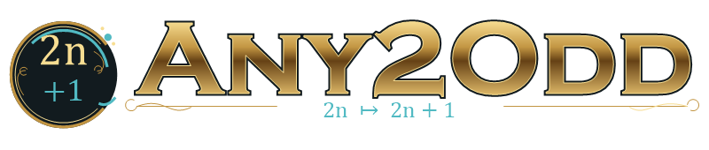
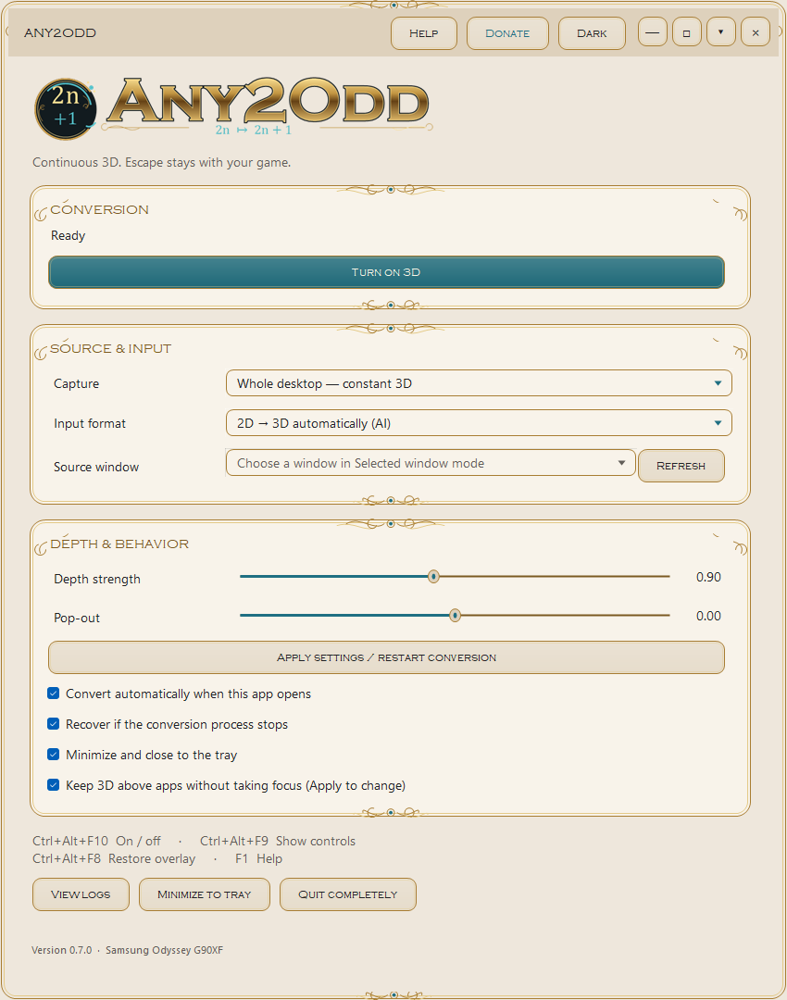
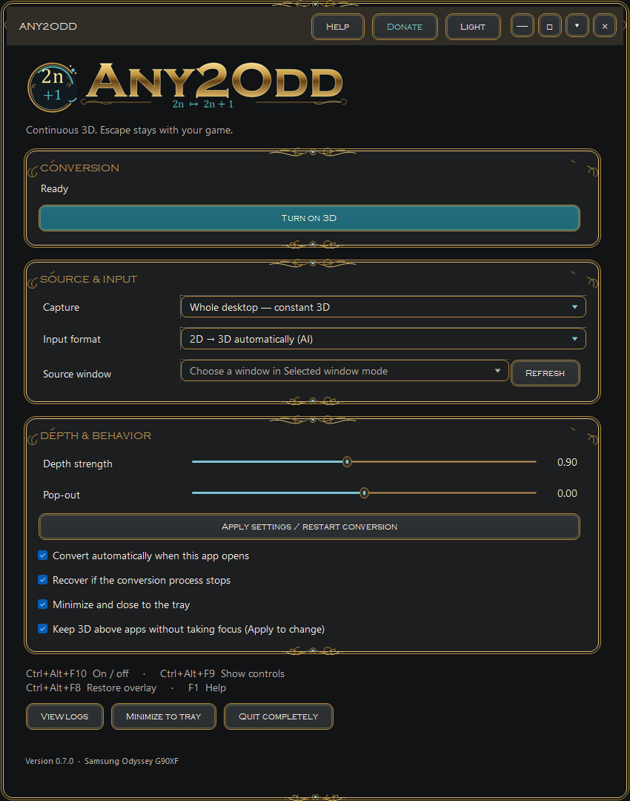
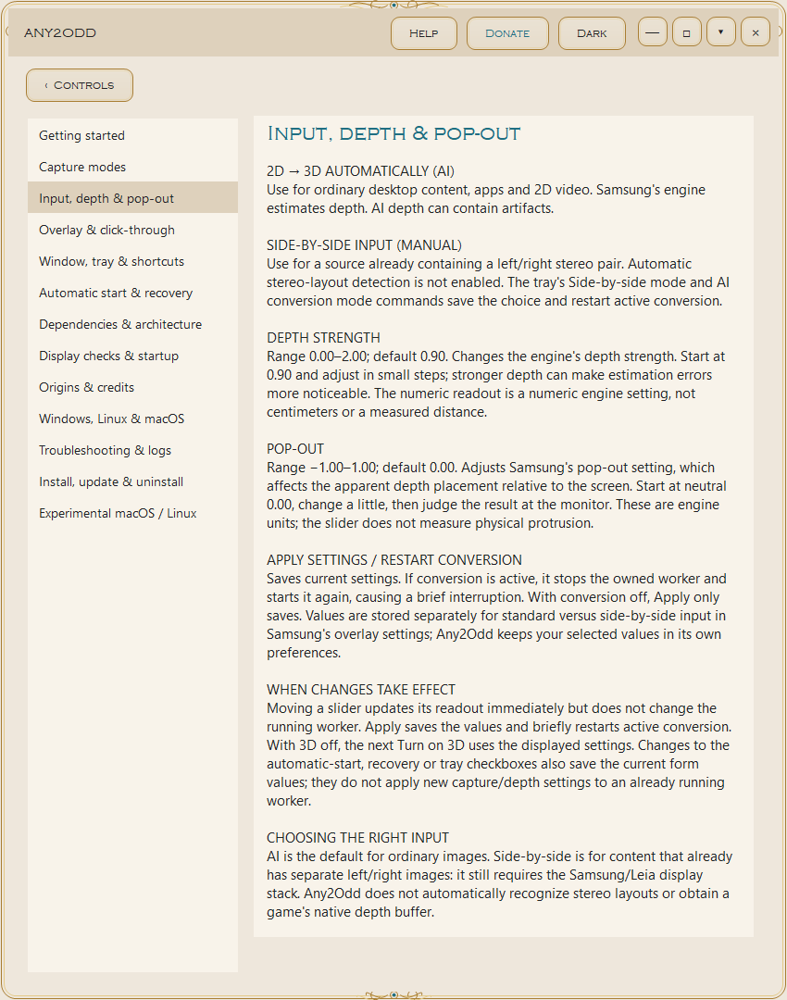
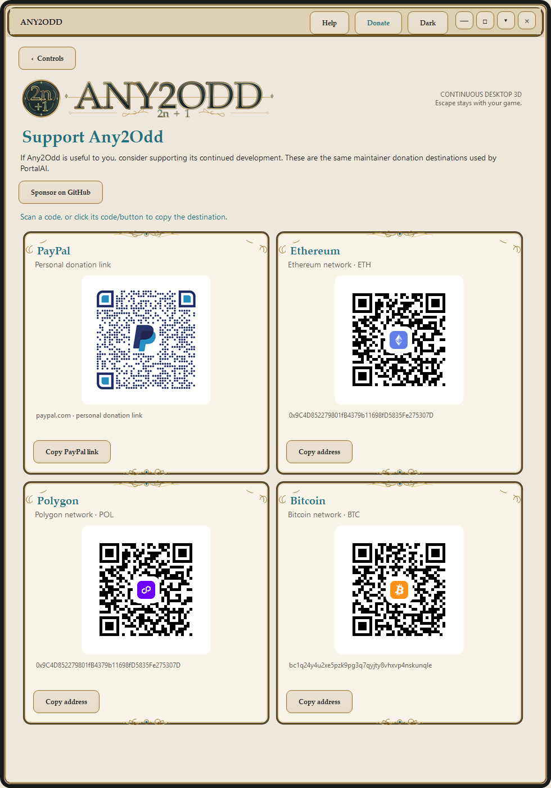

<p align="center"></p>

<h1 align="center">Any2Odd</h1>

<p align="center"><strong>Continuous desktop 3D for your Odyssey. Controls that stay out of the way.</strong></p>

<p align="center"><a href="#install">Download & install</a> · <a href="#a-look-inside">Interface gallery</a> · <a href="Documentation/README.md">Illustrated Help</a> · <a href="#requirements">Dependencies</a> · <a href="Documentation/PLATFORMS.md">macOS / Linux</a></p>

**0.7.1 (2026-11-05):** Installer errors now stay visible. Use **Install-GUI.cmd** to install just the Windows desktop controls without Odyssey Hub, or **Install.cmd** for the full converter. Written Help, illustrated GitHub documentation and sponsorship remain included. **macOS and Linux versions are experimental, not tested on those operating systems, and have limited stereo-format conversion; Samsung AI and calibrated Odyssey output remain Windows-only.**

<p align="center"><a href="https://github.com/sponsors/Zhandragon"></a><br/><sub>Support continued Any2Odd development · <a href="Documentation/DONATIONS.md">Donation options</a></sub></p>

**Continuous desktop 3D for the Samsung Odyssey G90XF.**

Any2Odd is a Windows application that minimizes to the system tray and turns capturable on-screen content into glasses-free 3D: wallpaper, desktop icons, app windows, web video, and compatible borderless games. Its continuous-conversion/tray workflow is inspired by **Any2C1, the companion/conversion app for CubeVi's C1 spatial display (Companion 01)**. Any2Odd implements that workflow separately for Samsung's Odyssey using the installed Samsung conversion engine. See [CubeVi's C1 guide](https://cubevi.com/pages/cube-c1-user-guide) and [software downloads](https://cubevi.com/pages/download-page) for the source hardware ecosystem; CubeVi's broader suite is called CubeStage. The project maintainer identified Any2C1 as the specific inspiration. **Any2C1, CubeStage, the CubeVi C1 and PortalAI are not dependencies.**

It works around Odyssey 3D Hub's normal fullscreen/video-window workflow by feeding a continuous desktop capture into its renderer. There is no per-video approval step. Escape remains available to games, and changing focus or opening menus does not intentionally stop conversion. The 3D overlay passes mouse input through to the real desktop or game underneath.

**Experimental, hardware-specific software.** The tested configuration is an Odyssey G90XF + RTX 4090, Windows 11, and Odyssey 3D Hub 1.5.1. It is not a standalone converter for arbitrary monitors. Samsung's software, camera, tracking and calibration are still required. No Samsung binaries, AI models or calibration files are included.

[Download a release](https://github.com/Zhandragon/Any2Odd/releases) · [Report an issue](https://github.com/Zhandragon/Any2Odd/issues) · [GPL-3.0 license](LICENSE)

## A look inside

**Windows controls, in light and dark.** Choose the source and input format, tune depth/pop-out, then use **Apply settings / restart conversion**. The checked automatic-start preference means "when this app opens"; the installer does not add Windows sign-in startup.

| Light | Dark |
| --- | --- |
| [](Documentation/assets/controls-light.png) | [](Documentation/assets/controls-dark.png) |

**Written Help and internal Donate.** F1 or the Help menu opens explanations of settings, defaults, dependencies, display checks and troubleshooting. Donate uses the original PortalAI QR images and the same maintainer sponsorship destination. Both pages live in the controls window.

| Settings Help | Donate |
| --- | --- |
| [](Documentation/assets/help-light.png) | [](Documentation/assets/donate-light.png) |

<sub>Real Windows widgets rendered in an isolated preview. Conversion was not started; these images do not demonstrate optical 3D or macOS/Linux operation. Click to see full size. [Artwork notes](Documentation/assets/README.md).</sub>

## Built-in Help and documentation

Open **Help** or press **F1** for written explanations inside the app. **Help → Open offline guide** opens the matching text-only HTML. The [GitHub Help page](Documentation/README.md) and this README add clickable screenshots in light and dark modes. Screenshots are not embedded in the app.

- [Capture/source selection](Documentation/README.md#capture), [input/depth/pop-out](Documentation/README.md#input), and [automatic start/recovery](Documentation/README.md#automation).
- [Dependency ownership](Documentation/README.md#dependencies), [what display checks actually detect](Documentation/README.md#detection), and [Any2C1 / CubeVi origins](Documentation/README.md#origins).
- [Tray, menus and shortcuts](Documentation/README.md#tray), [updates](Documentation/README.md#updates), and [experimental macOS/Linux usage](Documentation/README.md#portable).

## Windows features

- Whole-desktop AI conversion, enabled by default when the app opens.
- PortalAI-inspired light and dark themes, rounded controls, gold filigree borders and custom desktop window controls. The theme choice is remembered separately from conversion settings.
- A mathematical `2n + 1` emblem, engraved wordmark and a readable `+1` variation for small tray icons.
- A themed tray/window right-click menu, gold scrollbars, internal Help (F1) and Donate panels. Donate uses the same maintainer QR codes as PortalAI, embedded unchanged.
- Right-click the tray icon to turn 3D on/off, switch input modes, restore the overlay, open controls or quit. The taskbar icon's jump list also has toggle and controls commands.
- Close/minimize to tray by default; configurable normal minimize behavior.
- Depth strength and pop-out controls. Applying them briefly restarts conversion.
- Manual side-by-side input mode, selected-window capture, and follow-active-window mode.
- Click-through output that can stay above apps without taking keyboard focus.
- GPU capture with a bounded frame queue, capture-output exclusion to avoid feedback trails, and exclusion of the captured hardware cursor to avoid a delayed duplicate pointer.
- Borderless capture when Windows grants permission; respects Windows taskbar auto-hide.

Automatic side-by-side detection is **not implemented**. Select side-by-side manually when the source already contains a stereo pair. Whole desktop + AI conversion is the recommended default.

## Requirements

These requirements apply to the full Windows converter. **Controls-only installation** needs the Windows/runtime rows below, but no Hub, Samsung display or administrator access; it cannot perform 3D conversion. The experimental portable editions have [separate prerequisites and capabilities](portable/START-HERE.md).

| Component | Required / tested |
| --- | --- |
| OS | Windows 11 x64, 24H2 (build 26100) or newer; tested on build 26300 |
| Display | Samsung Odyssey 3D G90XF, primary monitor, landscape 3840 × 2160 |
| Connection | DisplayPort and the monitor's USB upstream connection; working `3D Stereo WebCam` |
| GPU | Tested on RTX 4090; this initial release passes a fixed 16,384-core hint to the native engine. Other GPUs are unvalidated |
| Samsung software | Odyssey 3D Hub 1.5.1 and its installed LeiaSR dependencies, in their default `C:\Program Files` locations |
| Runtime/install | .NET Framework 4.8 or compatible Windows-supplied 4.8.1; 64-bit Windows PowerShell 5.1 |

**Who supplies what:** Any2Odd supplies the desktop controls, capture, click-through/window management and four bundled **SharpDX 4.2.0** DLLs. Windows supplies WinForms/.NET, Win32/DWM, Windows Graphics Capture and Direct3D/DXGI. The build-26100 minimum corresponds to the capture code's [MinUpdateInterval API](https://learn.microsoft.com/en-us/uwp/api/windows.graphics.capture.graphicscapturesession.minupdateinterval). Samsung supplies the conversion engine and AI assets; Samsung/Leia components provide tracking, calibration and optical output. No Samsung/Leia binaries or models are bundled.

The Hub's main window is not explicitly required to stay open by Any2Odd's code, but its installed engine and working background runtime are required. The Hub may be needed to initialize them. Stop its separate **Odyssey3DPlayer** before conversion. Both AI and SBS input use that installed engine. Uninstalling Hub removes required components. No Any2C1/PortalAI install, system Python, Node, Visual Studio or separate CUDA Toolkit is needed for the prebuilt Windows package.

**Detection limits:** startup checks a 3840 × 2160 primary screen, a working `3D Stereo WebCam` device, the expected engine/worker and absence of Samsung's separate player. It does not identify the monitor's EDID/model, pick a compatible secondary display, or automatically activate on hot-plug. Failed prerequisites leave conversion off until you correct the issue and retry.

The app and installer check the exact `ConversionWrapper.dll` SHA-256:

```text
0116b33697ca0192fbe26da96cb9e2592599c0cacfbb1129ae03e445cb3a840b
```

A different engine stops installation/conversion with a compatibility message. Do not remove this check to try an unknown engine. Samsung updates may require an Any2Odd update.

## Install

### Windows controls without a 3D setup

On a PC without Odyssey Hub or the Samsung display, download and fully extract the Windows ZIP, then double-click **Install-GUI.cmd**. It installs the same themed controls, tray, written Help and Donate under your Windows account, creates desktop/Start menu shortcuts, and appears as **Any2Odd (controls only)** in Installed apps. No administrator access is needed. It does not install a conversion worker or change Samsung's folders.

**3D conversion is unavailable in this mode.** The automatic-conversion preference is unchanged: on first launch, the normal prerequisite check reports the missing engine or worker and leaves conversion off. You can uncheck **Convert automatically when this app opens** while using the controls.

Later, install the supported Samsung setup and run **Install.cmd** from the same or a newer release to add full conversion, preserving your settings. On a PC with an existing full installation, use **Install.cmd** to keep the app and worker versions together; controls-only setup refuses to replace an installed worker.

### Full Windows 3D converter

1. Install and configure Samsung Odyssey 3D Hub and verify that its ordinary 3D playback works. See [Samsung's setup guidance](https://www.samsung.com/uk/support/displays/how-to-use-3d-on-the-odyssey-3d-gaming-monitor/).
2. Download `Any2Odd-0.7.1-windows-x64.zip` from [Releases](https://github.com/Zhandragon/Any2Odd/releases) and extract it to a normal folder. The GitHub-generated **Source code** downloads need to be built first.
3. Stop Samsung's separate 3D player. The installer requests a clean shutdown of a running Any2Odd and waits for its worker. If it cannot stop, quit Any2Odd from its tray and retry.
4. Double-click **Install.cmd** and approve elevation **using the same Windows account** as the existing installation. Alternatively, open **64-bit PowerShell as administrator**, change to the extracted folder, and run:

```powershell
powershell.exe -NoProfile -ExecutionPolicy Bypass -File .\install.ps1
```

5. Open **Any2Odd** from its desktop or Start menu shortcut as your normal user. By default, conversion starts when the app opens. It does not register itself to start at Windows sign-in.

Administrator access is needed to install the worker beside Samsung's conversion engine. **No Windows restart is needed.** The installer adds its own worker and SharpDX dependencies; it does not patch Samsung's executables or DLLs. It preserves existing Any2Odd/Companion preferences.

Both launchers keep the specific error visible in the original console. Full setup checks prerequisites before requesting elevation and refuses elevation under a different Windows account.

For a read-only package/engine compatibility check, run `powershell.exe -NoProfile -ExecutionPolicy Bypass -File .\install.ps1 -CheckOnly`. Add `-ControlsOnly` to check GUI installation without requiring Hub. These checks do not test the camera or prove optical 3D operation.

### Experimental macOS and Linux downloads

**Not tested on macOS or Linux.** These are small source launch bundles, using Python 3.10–3.13 and PySide6/Qt. They provide themed controls/tray, written Help/Donate, SBS image viewing, red/cyan anaglyph conversion and a constrained experimental live-screen path. They do not include Samsung AI depth or calibrated Odyssey output. An ordinary 2D image stays flat.

| Platform | Release asset | After extraction |
| --- | --- | --- |
| Windows x64, full converter or controls only | [Windows installer ZIP](https://github.com/Zhandragon/Any2Odd/releases/download/v0.7.1/Any2Odd-0.7.1-windows-x64.zip) | `Install.cmd` or `Install-GUI.cmd` |
| macOS 13+, Intel / Apple silicon — experimental | [macOS launch bundle](https://github.com/Zhandragon/Any2Odd/releases/download/v0.7.1/Any2Odd-0.7.1-macos-experimental.zip) | `Launch-macOS.command` |
| Linux x86-64, glibc 2.34+ — experimental | [Linux launch bundle](https://github.com/Zhandragon/Any2Odd/releases/download/v0.7.1/Any2Odd-0.7.1-linux-experimental.tar.gz) | `sh launch-linux.sh` |

The portable launchers create a private virtual environment and download pinned Qt wheels on first launch. Read [setup and limits](portable/START-HERE.md) and the [platform capability matrix](Documentation/PLATFORMS.md). These bundles have no native macOS/Linux acceptance testing. The offline/shared-code tests were run on Windows only.

## Updating an existing installation

**Upgrade from 0.5.0, 0.6.0 or 0.7.0 without uninstalling.** Extract the new ZIP into a new folder and run `Install.cmd` on the computer with your 3D display. The installer detects the old executable, reports `Upgrade Any2Odd 0.5.0.0 -> 0.7.1`, and updates the same app, worker, shortcuts and Windows Installed apps entry. Your preferences, logs and original Samsung overlay-settings backup remain in place. Use `Install-GUI.cmd` to update a controls-only installation without adding conversion.

`VERSION` is the single release-version source. The installer checks it against the packaged executable, reads the installed executable version (with registry/manifest fallbacks), and distinguishes a new install, upgrade and same-version repair. It refuses to replace a newer version unless you explicitly use `-AllowDowngrade`. Failed file or registration updates attempt to restore the previous installation; if rollback cannot finish, the error identifies the retained backup folder. Shared Samsung-folder dependencies keep their existing ownership status.

Do not run the older 0.5.0 installer to update a newer installation; that old installer predates version checks. No reboot is required.

## Controls

| Action | Control |
| --- | --- |
| Light / dark theme | Title-bar Light / Dark button, or tray/window context menu |
| Help | Title-bar Help menu, context menu, or **F1** |
| Donate | Title-bar Donate button or context menu |
| Move / resize | Drag the custom title bar / borders; double-click title bar to maximize or restore |
| Turn 3D on/off | Tray right-click → Turn 3D on/off, or **Ctrl+Alt+F10** |
| Show controls | Double-click tray icon, desktop icon, or **Ctrl+Alt+F9** |
| Restore overlay without taking game focus | **Ctrl+Alt+F8** |
| Change depth/pop-out | Adjust sliders → Apply settings / restart conversion |
| Convert ordinary content | Whole desktop + 2D → 3D automatically (AI) |
| Show an existing stereo pair | Side-by-side input (manual) |
| End the application | Tray → Quit, or Quit completely in the window |

Escape is not a stop hotkey. Use borderless/windowed games. Leave **Keep 3D above other apps without taking focus** enabled for continuous output. Minimize the controls when playing.

## How it works

```text
Primary desktop → Windows Graphics Capture → off-screen GPU surface
                → installed Samsung conversion engine → tracked 3D overlay
```

The source surface is wholly outside all physical monitor rectangles. Windows excludes the final 3D output from capture, preventing recursive feedback. Real input reaches the underlying applications. Samsung's installed engine provides AI depth conversion and calibrated display output; Any2Odd supplies capture, window/input handling, settings and tray controls.

The worker lives next to Samsung's engine because that engine resolves assets relative to its executable. Any2Odd uses an unpublished native interface, so compatibility is deliberately narrow. It does not inject into games or change their files.

## Limits and troubleshooting

- **Setup reports missing Odyssey Hub:** use `Install-GUI.cmd` for desktop controls on a PC without a 3D setup. For full conversion, install the supported Samsung Hub and use `Install.cmd`. Version 0.7.1 keeps the underlying setup error visible; download the new ZIP if an old launcher only says installation did not complete.
- **Capture adds latency.** GPU capture reduced overhead in local testing, but this is not zero-latency native stereo rendering. Video/audio timing and responsiveness depend on GPU load, source and display. End-to-end latency has not been measured.
- **Not every surface can be captured.** Protected/DRM video, secure desktops, exclusive fullscreen, some overlays and apps that stop rendering when occluded may not work. This app does not bypass DRM, anti-cheat, camera or hardware requirements.
- **HDR input is normalized to SDR.** The conversion path is not native HDR; bright highlights can clip. Windows HDR settings are not changed.
- **AI depth is estimated.** Artifacts and inaccurate depth are possible. Ordinary screenshots cannot verify the monitor's optical 3D effect.
- **Yellow outline:** Windows may deny borderless-capture access. Conversion can continue with the capture indicator visible; the app does not disable Windows privacy protections.
- **No 3D / camera error:** check USB upstream, the camera in Device Manager, primary-display selection and 3840 × 2160 resolution. Confirm the Samsung player is stopped.
- **Overlay behind a game:** use Ctrl+Alt+F8 and enable “Keep 3D above other apps.” Exclusive fullscreen is unsupported.
- **Taskbar stays visible:** enable auto-hide in Windows. Any2Odd removes only its native renderer's stale taskbar entry, not other apps' notifications or Windows' taskbar behavior.
- **Hotkey conflict:** free Ctrl+Alt+F8/F9/F10 in other applications. Startup conversion is blocked if these controls cannot register.
- **Selected-window modes:** experimental; scaling a window does not remap mouse coordinates. Use whole-desktop mode for direct interaction and games.

Use **View logs** for local diagnostics. Review and redact usernames, window titles and file paths before attaching logs to a public issue. Include Windows build, GPU, Hub version, capture/input mode, and steps to reproduce.

## Build from source

On a compatible Windows installation:

```powershell
git clone https://github.com/Zhandragon/Any2Odd.git
cd Any2Odd
powershell.exe -NoProfile -ExecutionPolicy Bypass -File .\build.ps1
```

The build uses the .NET Framework C# compiler and Windows WinMetadata already on the machine; Visual Studio is not needed. `restore.ps1` downloads four **SharpDX 4.2.0** packages from NuGet, checks pinned SHA-256 hashes, and extracts their .NET 4.5 assemblies. SharpDX is an archived project. The icon and metallic wordmark are generated from `IconMaker.cs`. Small icons use a simplified `+1` mark; larger assets use `2n + 1`. No external font files are bundled.

Output: `build\Any2Odd.exe` plus four SharpDX DLLs. Donation QR images are embedded in the executable. The UI lives in `MainWindow.cs`, `DesktopTheme.cs`, `DesktopControls.cs`, `HelpContent.cs` and `DonationWindow.cs`; the capture and overlay surfaces do not inherit the desktop chrome. `python tools/export-guide.py` regenerates the self-contained offline HTML and GitHub illustrated guide from `Documentation/help.json`. The written catalog is embedded in Windows Help and reused by the portable frontend; screenshots are only for the GitHub pages. Use `package.ps1` to create the distributable ZIP and its checksum. All source needed to build Any2Odd is in this repository. The build produces a functionally equivalent executable; byte-for-byte reproducibility across machines/compiler metadata is not claimed.

See [TESTING.md](TESTING.md) for the checks and their scope, and [CHANGELOG.md](CHANGELOG.md) for the history.

## Installed files and removal

For compatibility with the former **Odyssey 3D Companion** name, internal directories and the worker filename remain:

| Item | Location |
| --- | --- |
| App | `%LOCALAPPDATA%\Programs\Odyssey3DCompanion\Any2Odd.exe` |
| Settings/logs | `%LOCALAPPDATA%\Odyssey3DCompanion` |
| Worker | `C:\Program Files\Odyssey 3D Hub\Conversion\OdysseyCompanionWorker.exe` |
| Original Samsung overlay settings backup | `%LOCALAPPDATA%\Odyssey3DCompanion\Samsung-OverlaySettings-before.json` |

Depth/overlay settings are written to Samsung's per-user `OverlaySettings.json`; its first existing version is backed up. Uninstall **Any2Odd** from Windows Installed apps, or run the installed `Uninstall.ps1`. The uninstaller removes its own files and unchanged dependencies it owns. It keeps Samsung's software, your preferences, logs and overlay-settings backup. It does not automatically restore that backup over newer Samsung preferences. Stop both players before restoring it manually if needed.

## License and acknowledgments

Any2Odd's own code and generated icon are licensed under **GPL-3.0-only**; see [LICENSE](LICENSE). Third-party MIT notices are in [THIRD-PARTY-LICENSES.txt](THIRD-PARTY-LICENSES.txt). Samsung/Leia software remains separately licensed and must be obtained independently; this repository grants no rights to redistribute it.

Inspired by Any2C1 for the **CubeVi C1 / Companion 01** spatial display, as identified by the project maintainer. CubeVi documents its hardware and CubeStage suite on its [official site](https://cubevi.com/pages/cube-c1-user-guide). Any2Odd is an independent project, not an Any2C1 fork and not affiliated with or endorsed by Samsung, Leia or Any2C1.

The desktop visual design references [PortalAI](https://github.com/Zhandragon/PortalAI). Its maintainer-supplied donation QR assets are reused unchanged; provenance and hashes are in `assets/donations/PROVENANCE.json`. Any2Odd and PortalAI are independent applications.
